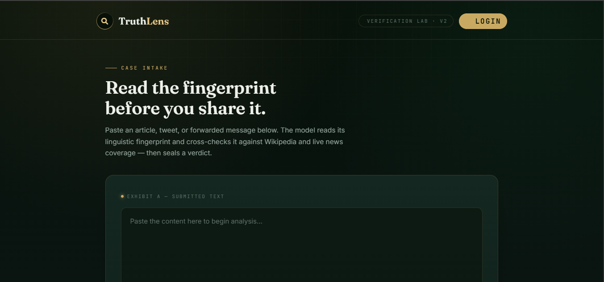
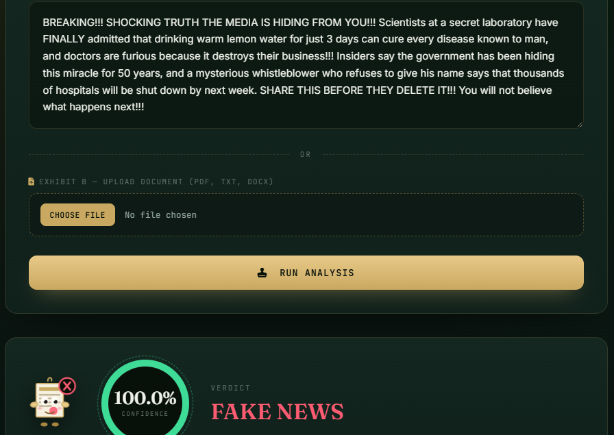
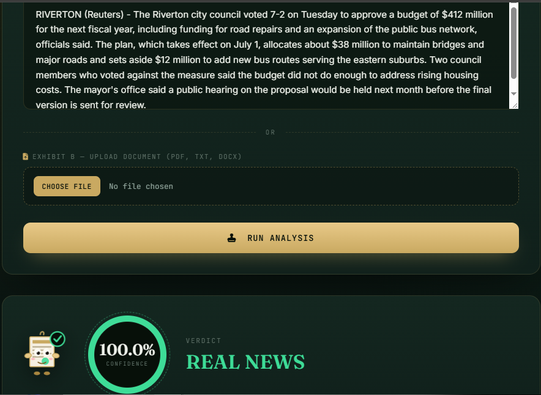

# TruthLens Lab - Fake News Detector

## 📸 Screenshots





A Django web app that checks whether a piece of news is **real or fake** using a
pre-trained RoBERTa deep learning model, and shows related Wikipedia and
Google News links so you can verify the claim yourself.

## Features

- User signup, login and logout
- Paste news text or upload a `.txt`, `.pdf` or `.docx` file
- Fake / Real prediction with a confidence percentage
  (model: [`hamzab/roberta-fake-news-classification`](https://huggingface.co/hamzab/roberta-fake-news-classification))
- Related Wikipedia and live Google News (RSS) links for fact-checking
- Scan history saved per user
- Django admin panel

## Tech stack

Python, Django, Hugging Face Transformers (PyTorch), scikit-learn, SQLite,
HTML/CSS

## Project structure

```
manage.py
download_model.py        # downloads the RoBERTa model (run once)
detector/                # main app (views, models, templates)
fakenews_web/            # Django project settings and urls
*.pkl                    # earlier TF-IDF / Random Forest model files
```

## How to run

1. Clone the repository and open the project folder:
   ```
   git clone https://github.com/Shajjarabbas365/fake-news-detector.git
   cd fake-news-detector
   ```
2. Create and activate a virtual environment:
   ```
   python -m venv venv
   venv\Scripts\activate          # Windows
   source venv/bin/activate       # Mac / Linux
   ```
3. Install the dependencies:
   ```
   pip install -r requirements.txt
   ```
4. Download the RoBERTa model (needs internet, about 500 MB, first time only):
   ```
   python download_model.py
   ```
5. Create the database:
   ```
   python manage.py migrate
   ```
6. Start the server:
   ```
   python manage.py runserver
   ```
7. Open http://127.0.0.1:8000/ and paste any news text to check it. (Login is optional and only needed to save your scan history.)

The first start takes a little longer because the model is loaded into memory.

Optional: to get your own admin account, run `python manage.py createsuperuser`
and open http://127.0.0.1:8000/admin/ .

## Notes

- The database (`db.sqlite3`) is not included in this repository. Step 5
  creates a fresh one.
- This project is for educational purposes. Predictions are not 100% accurate,
  so always verify important news with trusted sources.
- Before deploying publicly, set `DEBUG = False` and move `SECRET_KEY` into an
  environment variable.

## Author

Shajjar Abbas - [@Shajjarabbas365](https://github.com/Shajjarabbas365)
